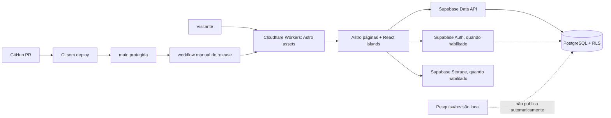

# Arquitetura, fronteiras de dados e ambientes

> Este documento descreve a implementação vigente no repositório, não promete que toda função esteja homologada no Worker oficial. Confira [Releases](https://github.com/krrozino/kukkiwon-ptbr-tkd/releases) para identificar a versão realmente implantada.

## Visão geral



## Componentes

| Camada | Implementação | Responsabilidade |
| --- | --- | --- |
| Interface | Astro 7 + React 19 + TypeScript | Rotas públicas, widgets e estados de interface |
| Atlas | SVG vetorial original, React e dados de regiões | Seleção, vistas, descrições anatômicas; termos técnicos só se publicados |
| Catálogo | Cliente Supabase + consultas/RPCs com RLS | Buscar registros elegíveis, filtrar e paginar |
| Escolas | React, Supabase Auth, dados e mídia opcionais | Currículos próprios, permissões e compartilhamento |
| Banco | PostgreSQL 17 no Supabase dedicado | Termos, fontes, relações, regiões, escolas e políticas |
| Pesquisa | JSON auditável, ferramentas locais e migrações propostas | Coleta e propostas editoriais; isoladas de produção |
| Hospedagem | Cloudflare Worker `kukkiwon-ptbr-tkd`, assets de `dist` | Distribuir o build público |
| Entrega | GitHub Actions + tag/Release pós-deploy | Integridade do SHA, CI, smoke HTTP e auditabilidade |

## Rotas públicas

- `/` — apresentação e entrada para o aprendizado.
- `/atlas` — corpo, regiões e superfícies.
- `/catalogo` — pesquisa e famílias, fichas elegíveis.
- `/tecnica?slug=...` — ficha técnica individual **quando publicada**.
- `/glossario` e `/fundamentos/alturas-e-direcoes` — conceitos/expressões liberados e fundamentos.
- `/poomsae` — introdução aos Taegeuk e, depois de aprovação, sequências publicadas.
- `/curriculos`, `/curriculo?id=...` e `/escolas` — currículos pessoais e escolares, conforme permissões.
- `/estudos`, `/aprender` — organização e exercícios baseados em conteúdo elegível.
- `/fontes` — referências acessíveis conforme visibilidade.
- `/pesquisa-local` — laboratório de pesquisa **não destinado à produção pública**; não confundir caminho de código com função pública.

## Fronteiras de segurança e editoriais

1. **Visitante não recebe segredo:** o navegador usa somente `sb_publishable_*` e URL do projeto. RLS e permissões do banco determinam os registros visíveis.
2. **Pesquisa é diferente de publicação:** conteúdo coletado/`draft` não pode ser servido como ficha técnica. O modo de revisão e o novo esquema de pesquisa não estão habilitados no build oficial.
3. **Referências rastreáveis:** fontes podem ser exibidas quando ligadas a termos e relações publicadas, não para vazar documentos usados só por rascunhos.
4. **Identidade escolar não é editorial:** professor que edita currículo próprio não pode homologar o catálogo canônico.
5. **Mídia exige direitos:** evidência de autoria/licença/permissão antes da divulgação; uma URL pública não substitui licença.
6. **CI não publica:** `check.yml` roda no PR e push de `main`, enquanto `deploy-official-cloudflare.yml` é manual e tem gate no SHA exato.
7. **Sem vínculo com EloDo:** autenticação, banco, dados e lançamento deste projeto são independentes.

## Esquema aplicado e esquema proposto

As migrações remotas foram verificadas em 06/11/2026:

| Migração | Estado no Supabase dedicado |
| --- | --- |
| `20261103205602_catalogo_publico_inicial` | Aplicada |
| `20261103220044_atlas_media_e_integridade_de_fontes` | Aplicada |
| `20261105020254_sprint_catalog_search_relations` | Aplicada |
| `20261105115448_sprint02_schools_learning` | Aplicada |
| `20261105203201_sprint03_school_images` | Aplicada |
| `20261106152500_knowledge_research_and_poomsae` | **Proposta, não aplicada remotamente** |

Atenção: existir um arquivo SQL no Git **não** prova que a migração foi aplicada. Confira a lista de migrações remotas com ferramentas apropriadas antes de mudar flags. Não executar `db push` sem autorização, plano de backup e revisão de RLS.

No último inventário: **105 termos remotos em draft e zero published**. Os 108 registros versionados e os 115 candidatos de pesquisa pertencem a inventários diferentes. Não somar nem importar automaticamente.

## Variáveis e ambientes

| Variável | Tipo | Uso |
| --- | --- | --- |
| `PUBLIC_SUPABASE_URL` | Pública | Endpoint de leitura/autenticação do projeto dedicado |
| `PUBLIC_SUPABASE_PUBLISHABLE_KEY` | Pública | Chave pública do browser; RLS obrigatória |
| `PUBLIC_CONTENT_REVIEW` | Pública/de build | `false` na versão oficial para impedir exposição editorial |
| `PUBLIC_SPRINT02_SCHEMA` | Build | Recursos de escola condicionados à migração Sprint 02 |
| `PUBLIC_SPRINT03_STORAGE` | Build | Recursos de armazenamento condicionados à Sprint 03 |
| `PUBLIC_KNOWLEDGE_SCHEMA` | Build | `false` até migração e homologação dos novos modelos |
| `CLOUDFLARE_ACCOUNT_ID` | Secret de CI | Conta Cloudflare correta |
| `CLOUDFLARE_API_TOKEN` | Secret de CI | Permissão restrita de publicação |
| `SUPABASE_PUBLISHABLE_KEY` | Secret de CI | Injeta a **chave pública** no build de produção |

Os três últimos são configurados no GitHub Environment `production`; o token Cloudflare **nunca** deve ir para o navegador. Veja [runbook](GITHUB_RELEASES.md).

**Local:** `npm run dev` e teste com `.env` não versionado. **CI:** fixtures e banco efêmero PGlite; não escreve no remoto. **Produção:** somente workflow manual, flags explícitas, `dist`, smoke HTTP e Release pós-deploy.

## Estrutura do repositório

```text
src/
  pages/            # páginas Astro
  components/       # ilhas React: atlas, catálogo, escola, estudos
  lib/              # contratos/cliente do catálogo, currículo, Poomsae
  styles/
supabase/migrations/ # migrações propostas e aplicadas, controladas no Git
content/             # lotes de pesquisa e esquemas de validação
scripts/             # verificações, auditoria e preparação de prévia
tests/               # unitários e E2E
tools/local-validation/ # validação offline e integração isolada
workers/             # configurações auxiliares
.github/workflows/   # CI e release manual
docs/                # documentação pública, técnica e histórica
```

## Dependências e operações

- [Instalação e testes](GETTING_STARTED.md)
- [Banco/RLS](DATABASE.md) e [modelo de conhecimento](KNOWLEDGE_MODEL.md)
- [Pipeline](DATA_PIPELINE.md) e [política editorial](CONTENT_POLICY.md)
- [Release e rollback](GITHUB_RELEASES.md)
- [Segurança](../SECURITY.md)

Não criar endpoint privilegiado de publicação sem aprovação; evitar funções `SECURITY DEFINER` desnecessárias e acesso por `user_metadata` em regras de autorização.