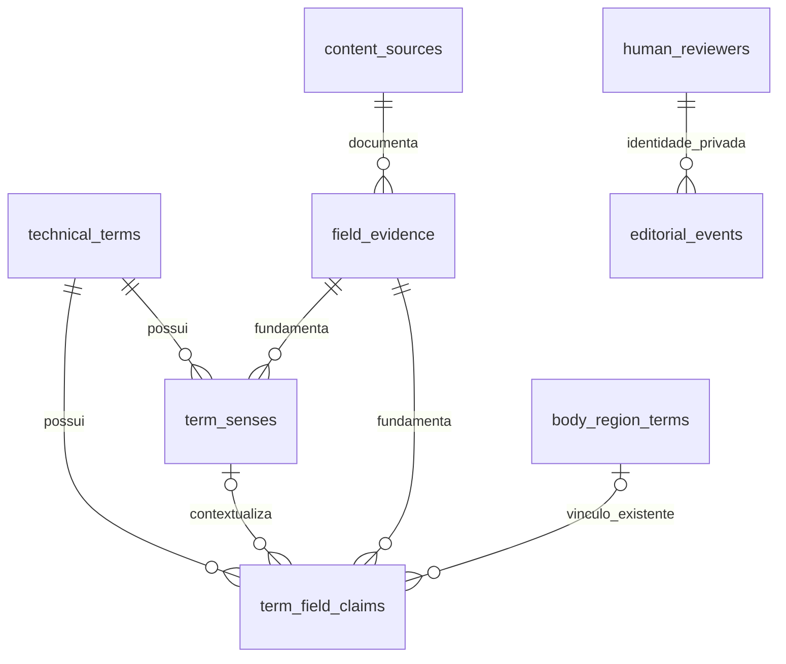

# ADR-009 — sentidos e afirmações documentais (Issue #42)

Estado: proposta implementada e testada localmente; migração não aplicada remotamente, aprovação pendente.

## Decisão e plano breve

Reutilizar `technical_terms` como identidade, `content_sources` como documento,
`knowledge_research.field_evidence` como observação imutável e os revisores/eventos
privados existentes. Acrescentar somente `term_senses` e `term_field_claims`.

1. Testar múltiplos sentidos, evidência exata, variantes, isolamento e revogação.
2. Criar SQL aditivo e tipos/validação TypeScript, sem mudar consultas existentes.
3. Executar testes e checks disponíveis; entregar Draft PR com limitações.

Um sentido contém significado, tipo (literal, técnico, contextual, histórico ou
regional), idioma e contexto. Cada sentido tem evidência primária; afirmações
adicionais podem referenciar o sentido. Uma afirmação preserva o valor original
por campo, seu documento/contexto e eventual classificação como variante. Vários
valores conflitantes são permitidos: nenhuma escolha ou fusão é automática.

Não estender `term_aliases` para armazenar pesquisa: aliases legados herdam a
visibilidade do termo e não possuem revisão individual. Afirmações com variantes
são observações documentais, não um segundo catálogo de aliases de busca. A
eventual adoção como alias permanece uma decisão editorial separada.

Cada linha aponta a uma evidência privada do mesmo termo, campo e valor. O banco
extrai documento/localizador e uma projeção bibliográfica segura do snapshot já
imutável. A projeção pública não inclui ID de evidência ou identidade de revisor.
Não é necessário ampliar a RLS de `content_sources`: a citação via snapshot é
autossuficiente e não concede acesso ao documento privado completo.

O vínculo anatômico opcional da afirmação referencia a chave existente
`(region_id,term_id,usage_context)` de `body_region_terms`. Região ilustrativa,
superfície, alvo e movimento continuam distintos. Hangul não é obrigatório para
uma região geométrica. Diferenças podem apontar a outro termo por ID; nomes
parecidos e Hangul igual não são chaves de identidade.

## Estados e segurança

Preservar `editorial_status=research|document_checked|technical_reviewed` e
`publication_status=draft|published|retired`. `document_checked` exige conferência
datada; `technical_reviewed` e publicação exigem `auth.uid()` na lista ativa de
revisores. Não criar revisores reais, serviço editorial ou promoção automática.
Qualquer edição de linha tecnicamente revisada exige nova revisão; downgrade
remove a assinatura. Eventos privados guardam antes/depois, inclusive exclusões;
TRUNCATE é bloqueado. Uma conexão administrativa permanece fronteira de confiança.

RLS nova somente nas duas tabelas: publicação individual e pais publicados.
Retirar termo, sentido, outro termo ou região da publicação oculta os respectivos
dependentes. Contas escolares não ganham escrita global. Evidência ausente,
divergente ou URL insegura bloqueia a projeção, mesmo em rascunho.

## Alternativas e consequências

JSON em `technical_terms` reduziria tabelas, mas dificultaria FK e revisão por
sentido. Duplicar pesquisa/revisores/documentos desperdiçaria contratos existentes.
As duas tabelas aditivas preservam IDs, catálogo, Poomsae e currículos; não alteram
as flags `PUBLIC_CONTENT_REVIEW` e `PUBLIC_KNOWLEDGE_SCHEMA`.

As fixtures são propostas de teste baseadas nos lotes versionados, nunca
homologação técnica. Sentidos literais sem documento lexical ficam como lacuna.
Não há seed, aplicação remota, publicação de conteúdo ou ativação da UI.

## Validação local e aplicação posterior

Além do PGlite, a suíte foi executada em PostgreSQL portátil 17.11 e PostgREST
16.5 já disponíveis no computador. Foram criados clusters descartáveis em
loopback, sem Docker, instalação de serviços ou banco remoto. Os binários foram
reutilizados por junctions dentro desta worktree; o outro checkout não foi editado.
O snapshot das oito tabelas/108 rascunhos permaneceu idêntico após a migração.

Os testes reais verificam RLS/grants, revisão, evidência, variantes, revogação e
projeções HTTP com JWTs de teste. Não equivalem a Supabase completo: Auth e gateway
do serviço hospedado não foram executados. Antes de aplicar: aprovação e backup,
comparar schema/histórico remoto com as migrações e validar Auth/PostgREST no
ambiente Supabase autorizado. Sem Docker, esse stack completo permanece pendente;
nenhuma política ou configuração de produção foi alterada.
