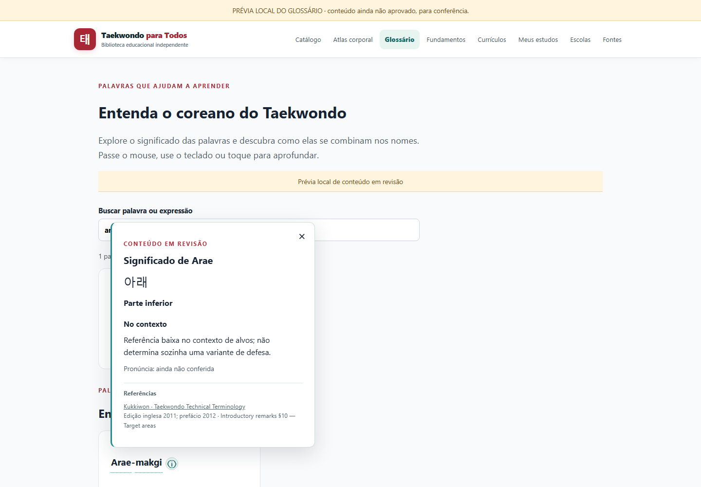
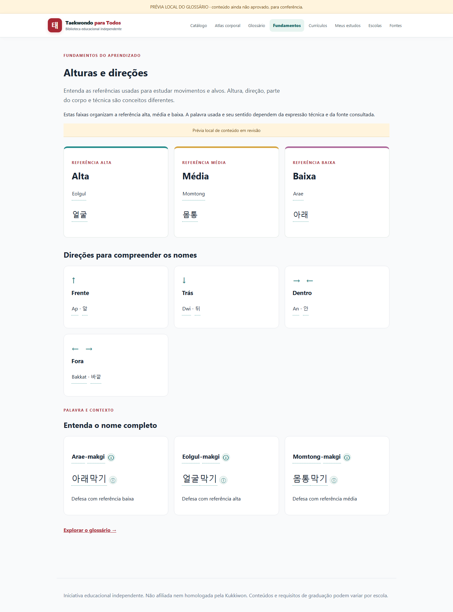

# Glossário e fundamentos — revisão do primeiro lote

Esta entrega implementa a experiência e prepara **15 palavras e 3 expressões**
para revisão. Nenhuma entrada nova está aprovada para publicação.

## Consultar a prévia

Na raiz do projeto, executar `npm run glossary:preview` e abrir
`http://127.0.0.1:4324/glossario` ou `/fundamentos/alturas-e-direcoes`.
O servidor escuta somente no computador local. O build fica em
`.preview-build/glossary`, com faixa explícita de conteúdo em revisão e sem
credenciais do catálogo remoto. Ctrl+C encerra o servidor.

`npm run glossary:preview -- --build-only` apenas prepara o pacote de revisão.
Isso não é um comando de deploy. Não reutilizar esse pacote na produção.
Os testes de navegador usam `.preview-build/glossary-review`. Um build com
revisão habilitada é recusado se seu destino for o diretório oficial `dist`.

## Arquivos de conteúdo

- `content/glossary/review.json`: propostas de Hangul, romanização, tradução,
  contexto, aliases de busca e referências. Datas de conferência e responsáveis
  permanecem vazios; preenchê-los exige conferência e aprovação reais.
- `content/glossary/approved.json`: somente entradas aprovadas; começa vazio.
  Após aprovação do usuário e do revisor técnico, copiar as entradas liberadas
  para este arquivo com referências conferidas e metadados de revisão.
- Uma expressão só pode ser liberada se todas as suas palavras também estiverem
  no arquivo aprovado. Os segmentos de romanização e Hangul são explícitos.

`npm run glossary:check` confere o arquivo público. O mesmo validador é executado
pela configuração Astro, incluindo builds diretos. Ao final de um build público,
uma segunda verificação recusa a presença do identificador ou dos textos
contextuais do lote que ainda não foi aprovado.

## Pontos para conferência humana

Conferir significado literal e aplicação contextual separadamente, a grafia e o
Hangul de Mok/Teok e os aliases familiares de busca. As expressões Arae-makgi,
Eolgul-makgi e Momtong-makgi não são automaticamente declaradas sinônimos de
famílias inteiras. Seus nomes de uso precisam ser vinculados à variante exata
documentada. Os três exemplos não possuem uma ficha técnica inventada.

O módulo de alturas é independente do atlas e não descreve alvos permitidos de
competição nem requisitos universais de graduação. Traduções são propostas
editoriais em português. As fontes do primeiro lote apontam à edição inglesa
publicada em 2011, com prefácio de 2012; o anúncio dos livros de 2022 não foi
usado como se contivesse o texto técnico desses livros.

## Interação

Mouse/foco mostra o significado curto. Clique/toque abre um painel não modal
com palavra ou expressão, sentido contextual e referências. Escape fecha e
devolve foco sem rolar a página. A ficha e a ficha contextual só recebem
segmentos quando há correspondência editorial explícita; outros títulos
continuam em texto simples. Links de ficha exigem um registro publicado.

## Verificação desta entrega

- Tipos: `npm run check`, sem diagnósticos.
- Unitários: `npm test`, 58 testes aprovados.
- Navegador: `npm run test:ui`, 88 testes aprovados em desktop e celular.
- Pacote público: build padrão e `node tools/local-validation/glossary-public.mjs`,
  sem lote em revisão e sem erros de JavaScript nos dois dispositivos.
- A suíte específica do glossário também cobre aliases em expressões completas,
  Escape no tooltip, painel sem deslocamento e retorno de foco.

As capturas abaixo usam a prévia local de revisão, com propostas ainda não
liberadas. O build público apresenta somente os registros aprovados.

A captura de celular está em [palavra-celular.png](palavra-celular.png).
